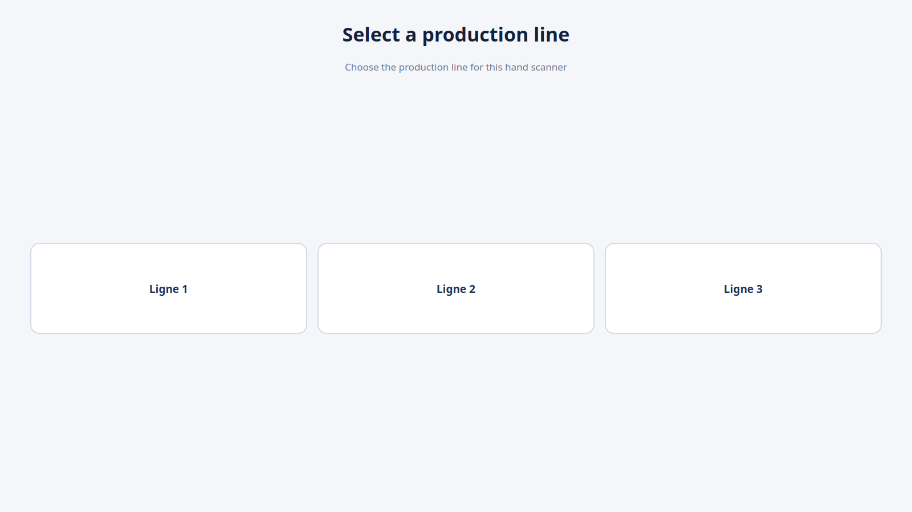
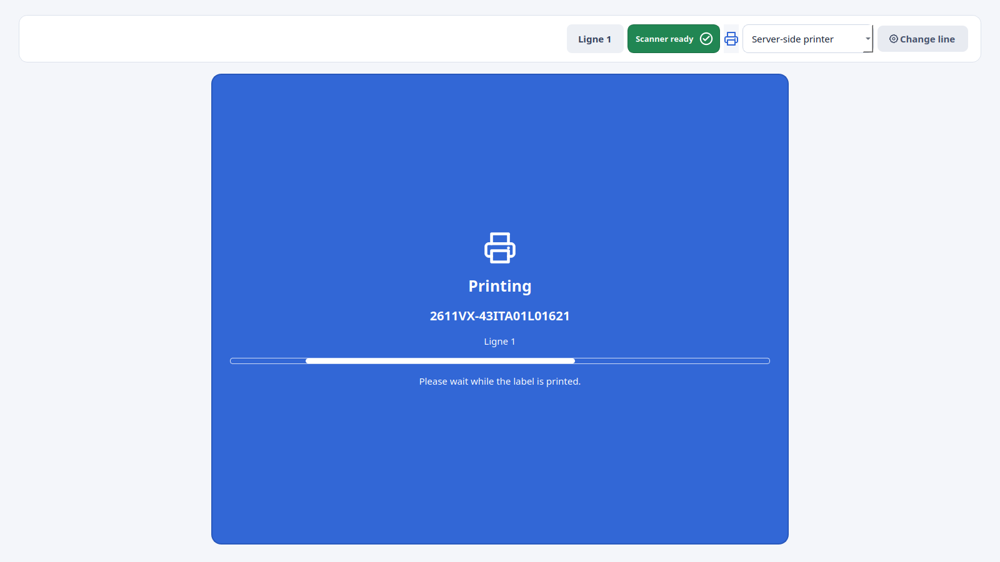
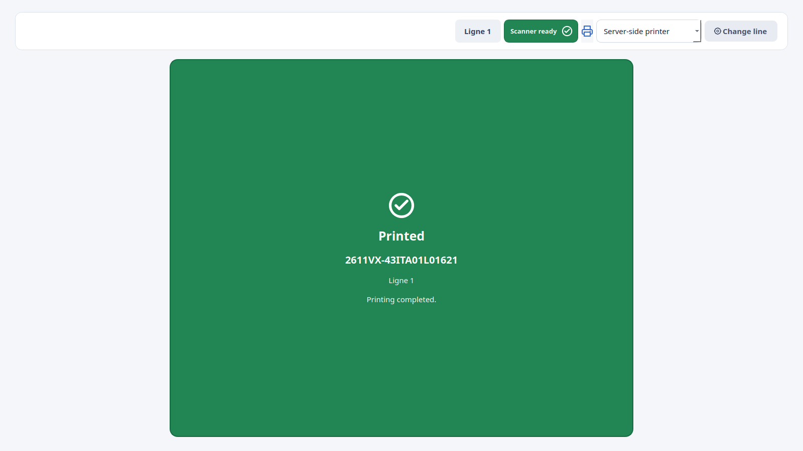

# MES End Assemblage Desktop

> Part of the [MES platform](../README.md). Station 3: closes assembly, obtains the TV serial from the daemon and prints its label. Screenshots show demo data.

| Line selection | Printing | Printed |
| --- | --- | --- |
|  |  |  |

Desktop application for the Assembly End station. It connects to the MES
service, loads production lines, reads a barcode scanner, submits Station 3
scans, and handles label printing.

The application supports Windows and Ubuntu.

## Requirements

- Python 3.10 or newer when running or building from source
- A reachable MES service
- A supported barcode scanner
- A label printer when using client-side printing

Install the Python dependencies from `requirements.txt` inside a virtual
environment. The Windows executable and Ubuntu DEB already bundle the Python
application, so users installing those packages do not install Python or the
contents of `requirements.txt` separately.

## Configuration

The application is configured through `settings.json`:

```json
{
  "BASE_URL": "http://localhost:8001",
  "PORT": "/dev/input/by-path/pci-0000:00:14.0-usb-0:1:1.0-event-kbd",
  "PORT_BAUD": 9600,
  "PRINT_MODE": "server",
  "SCANNER_KEYBOARD_LAYOUT": "azerty"
}
```

### `BASE_URL`

`BASE_URL` is the root address of the MES service. Any valid address placed in
this variable is treated as the application server.

Examples:

```json
"BASE_URL": "http://localhost:8001"
```

```json
"BASE_URL": "http://192.0.2.17:8001"
```

Do not add a trailing `/`. The application automatically uses these endpoints:

```text
GET  <BASE_URL>/api/health
GET  <BASE_URL>/api/production-lines
POST <BASE_URL>/api/hand-scanner
```

### `PORT`

`PORT` is the scanner device. The application automatically detects whether
the configured device is serial or Linux HID. There is no scanner-mode setting.

Examples:

```json
"PORT": "COM6"
```

```json
"PORT": "/dev/input/by-path/pci-0000:00:14.0-usb-0:1:1.0-event-kbd"
```

```json
"PORT": "/dev/serial/by-path/pci-0000:00:14.0-usb-0:2:1.0"
```

`"PORT": "auto"` is not supported.

### `PORT_BAUD`

Serial scanner speed. The usual value is:

```json
"PORT_BAUD": 9600
```

It is ignored when `PORT` points to a Linux HID device.

### `PRINT_MODE`

Use server-side printing:

```json
"PRINT_MODE": "server"
```

Use an active physical printer configured on the desktop computer:

```json
"PRINT_MODE": "client"
```

Client mode uses the Windows print system or CUPS on Ubuntu. Ubuntu accepts
ready direct physical queues using USB, HP USB, serial, or parallel transport.
Virtual and unrelated network queues are not accepted. The application
automatically selects the active system-default physical printer, or the first
ready physical printer when the default is unavailable. Every successful scan
is sent directly to that printer without opening a print dialog or requiring
operator confirmation. If the printer disconnects, scanning is blocked until a
ready physical printer is detected again.

### `SCANNER_KEYBOARD_LAYOUT`

This applies only to Linux HID scanners:

```json
"SCANNER_KEYBOARD_LAYOUT": "azerty"
```

or:

```json
"SCANNER_KEYBOARD_LAYOUT": "qwerty"
```

Serial scanners and Windows COM scanners ignore this value.

## Configuration file locations

- Source run: `settings.json` in the project directory.
- Windows build: `settings.json` beside `MES-End-Assemblage.exe`.
- Ubuntu installation:
  1. `/etc/mes-end-assemblage/settings.json`
  2. `settings.json` beside the executable, as a portable fallback

The Debian package uses `/etc/mes-end-assemblage/settings.json` as its single
authoritative configuration. Invalid JSON, an invalid `BASE_URL`, or an empty
`STATION_SECRET` is displayed as a configuration error instead of silently
falling back to localhost. Restart the application after changing settings.

## Find the scanner port

### Ubuntu HID scanner

Run:

```bash
ls -l /dev/input/by-path/*event-kbd 2>/dev/null
```

The WCM scanner connected to this workstation uses:

```text
/dev/input/by-path/pci-0000:00:14.0-usb-0:1:1.0-event-kbd
```

Ubuntu may also show:

```text
/dev/input/by-path/pci-0000:00:14.0-usbv2-0:1:1.0-event-kbd
```

Both point to the same scanner. Use the first path without `usbv2`.

Do not save `/dev/input/event15`; event numbers can change. A `by-path` value
identifies the physical USB socket, so keep the scanner connected to the same
socket.

### Ubuntu serial scanner

Run:

```bash
ls -l /dev/serial/by-path/ 2>/dev/null
```

The ZLWW scanner connected to this workstation uses:

```text
/dev/serial/by-path/pci-0000:00:14.0-usb-0:2:1.0
```

Ubuntu may also show the equivalent `usbv2` path. Use the first path without
`usbv2`. It currently resolves to `/dev/ttyACM0`, but the `by-path` value should
be placed in `settings.json`.

If `/dev/serial` does not exist, no serial scanner is currently connected. An
HID scanner appears under `/dev/input/by-path` instead.

### Windows scanner

The Windows application expects a serial or virtual-COM scanner.

1. Connect the scanner.
2. Open **Device Manager**.
3. Open **Ports (COM & LPT)**.
4. Copy the scanner port, such as `COM6`, into `settings.json`.

If the scanner types into Notepad but does not create a COM port, configure the
scanner as USB CDC, Virtual COM, or USB Serial using its manufacturer manual.

## Run from source

### Ubuntu

```bash
cd ~/Desktop/MES/MES-End-Assemblage
python3 -m venv .venv
source .venv/bin/activate
python -m pip install -r requirements.txt
python main.py
```

### Windows

Run in Command Prompt:

```cmd
cd /d C:\path\to\MES\MES-End-Assemblage
py -3.10 -m venv .venv
call .venv\Scripts\activate.bat
python -m pip install -r requirements.txt
python main.py
```

## Build for Windows

Windows builds must be created on Windows.

```cmd
cd /d C:\path\to\MES\MES-End-Assemblage
py -3.10 -m venv .venv-build
call .venv-build\Scripts\activate.bat
python -m pip install -r requirements.txt
python -m PyInstaller --clean --noconfirm MES-End-Assemblage.spec
copy /Y settings.json dist\settings.json
```

The release files are:

```text
dist\MES-End-Assemblage.exe
dist\settings.json
```

Both files must remain together.

Optional ZIP package:

```powershell
Compress-Archive -Force `
  -Path dist\MES-End-Assemblage.exe,dist\settings.json `
  -DestinationPath dist\MES-End-Assemblage-1.1.1-Windows.zip
```

## Build for Ubuntu

Ubuntu builds must be created on Ubuntu.

Use a version newer than the package already installed on production PCs.
App Center treats a higher version as an upgrade. Client printing requires the
standard CUPS `lp` and `lpstat` commands; the DEB installs `cups-client` as a
dependency.

```bash
cd ~/Desktop/MES/MES-End-Assemblage
python3 -m venv .venv-build
source .venv-build/bin/activate
python -m pip install -r requirements.txt
python build_deb.py --version 1.1.1
```

This rebuilds the application and creates:

```text
dist-linux/mes-end-assemblage_1.1.1_amd64.deb
```

For the next release, use `1.1.2`, then `1.1.3`, and so on. To package an
already-built `dist-linux/MES-End-Assemblage` directory:

```bash
python build_deb.py --version 1.1.1 --skip-app-build
```

## Install on Ubuntu

```bash
sudo apt install ./dist-linux/mes-end-assemblage_1.1.1_amd64.deb
```

Installing a higher version upgrades the existing installation; uninstalling
first is unnecessary. To reinstall the exact same version from a terminal:

```bash
sudo apt install --reinstall ./dist-linux/mes-end-assemblage_1.1.1_amd64.deb
```

Launch it from the application menu or run:

```bash
mes-end-assemblage
```

Edit the system configuration with:

```bash
sudoedit /etc/mes-end-assemblage/settings.json
```

Validate the exact JSON and permissions before starting the station:

```bash
python3 -m json.tool /etc/mes-end-assemblage/settings.json >/dev/null
sudo chown root:root /etc/mes-end-assemblage/settings.json
sudo chmod 0644 /etc/mes-end-assemblage/settings.json
curl --noproxy '*' --fail --show-error \
  http://192.0.2.10:1234/api/health
```

Grant the logged-in station user access to serial scanners, Linux input-event
scanners, and local printer devices. Replace `$USER` if installation is being
performed from a different administrator account:

```bash
sudo usermod -aG dialout,input,lp,lpadmin "$USER"
```

Log out of the desktop session completely and log back in after changing group
membership. Do not run the graphical application as root and do not use
`chmod 777` on scanner devices.

Remove the old application while keeping its system settings:

```bash
sudo apt remove mes-end-assemblage
```

Remove the application and `/etc/mes-end-assemblage/settings.json`:

```bash
sudo apt purge mes-end-assemblage
```

## Troubleshooting

### Scanner is disconnected

- Confirm the path in `PORT` still exists.
- Keep each `by-path` scanner connected to its original USB socket.
- Close other applications that may be using the scanner.
- Restart the application after changing `PORT`.

For serial permission errors, the Ubuntu user normally needs the `dialout`
group. For HID permission errors, the user must be able to read the configured
`/dev/input/by-path/...-event-kbd` device.

### Scanner text is incorrect

For a Linux HID scanner, change `SCANNER_KEYBOARD_LAYOUT` between `azerty` and
`qwerty`. This setting does not affect serial scanners.

### Server connection fails

Confirm that `BASE_URL` contains the correct reachable address and port. Do not
include `/api` or a trailing `/`; the application adds its endpoint paths.

### Printer is not displayed

- Confirm `PRINT_MODE` is `client`.
- Confirm the printer is connected and ready.
- Ubuntu uses a ready direct physical CUPS queue such as `usb://...` or
  `hp:/usb/...`.
- Windows uses a physical USB/DOT4 printer queue.

Use `PRINT_MODE: "server"` when printing is handled by the MES service instead.

### Settings changes are ignored

- Restart the application.
- Confirm the JSON syntax is valid.
- Source runs use the project `settings.json`.
- On Ubuntu, the user settings file overrides the system settings file.
- Rebuild and reinstall packaged applications to receive source-code changes.
