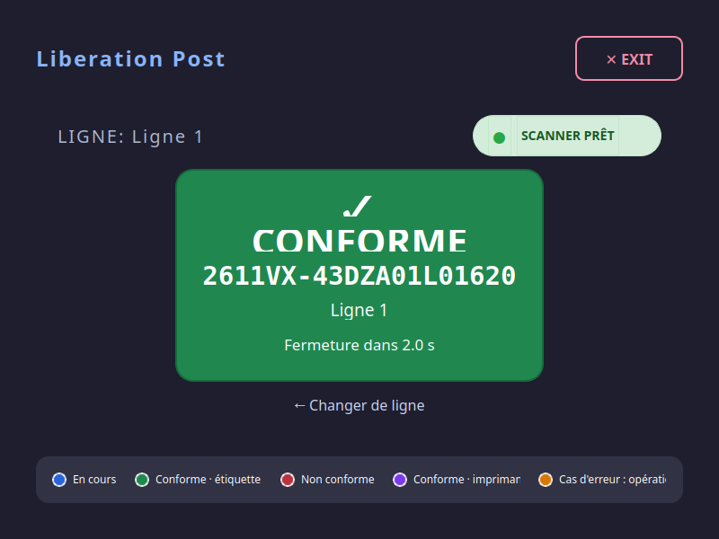

# MES Liberation App

> Part of the [MES platform](../README.md). Station 13: records the conform or non-conform decision and prints the release ticket. Screenshots show demo data.

| Line selection | Waiting | Conform unit |
| --- | --- | --- |
|  |  |  |

MES Liberation App is a full-screen production-station client. It loads production lines from MES, reads product barcodes, submits liberation checks, shows conforming/non-conforming results, plays feedback sounds, generates the approved 4×6 unit ticket locally, and sends it directly to the printer as raw ZPL.

The same source supports Windows and Ubuntu. Platform differences are isolated in scanner, printer, runtime-path, and packaging modules. Build on the operating system that will run the package; PyInstaller does not cross-compile Windows binaries from Linux or Linux binaries from Windows.

## Project structure

| Path                         | Purpose                                               |
| ---------------------------- | ----------------------------------------------------- |
| main.py                      | PyQt UI, workers, MES requests, and scan workflow     |
| barecode.py                  | Scanner selection plus serial and Linux HID readers   |
| printer_guard.py             | Physical-printer discovery for Windows and Ubuntu     |
| printing.py                  | Raw ZPL transport to `PRINTER_DEV_USB`                |
| ticket_zpl.py                | Local 4×6 unit-ticket artwork and ZPL generation      |
| ubuntu_usb_printer.py        | Optional Ubuntu raw-USB ZPL output                    |
| network_guard.py             | MES URL validation and connectivity check             |
| settings.py                  | Loads and validates settings.json                     |
| runtime_support.py           | Resource, executable, and log paths                   |
| guard_policy.py              | Network/printer stopping-screen decision policy       |
| job_panel.py                 | UI card for a liberation job                          |
| assets/                      | UI icons and bundled offline label fonts              |
| main.spec                    | Platform-aware PyInstaller definition                 |
| build.py                     | Native build command and settings deployment          |
| build_deb.py                 | Builds the complete single-file Ubuntu Debian package |
| packaging/linux/             | Debian control metadata and application-menu entry    |
| test_cross_platform.py       | Portable regression tests                             |
| test_scanner.py              | Interactive scanner diagnostic                        |
| confirm.wav, non-confirm.wav | Operator feedback sounds                              |
| datamax-o'neil_driver.exe    | Optional Windows vendor printer driver                |

Generated build/ and dist/ directories are ignored by Git.

## Requirements

Common requirements:

- Python 3.10 or newer
- network access to the configured MES server
- a supported barcode scanner
- a configured physical printer when labels must be printed

The production Liberation station must expose its physical ZPL printer through the configured `PRINTER_DEV_USB` path.

Ubuntu additionally needs Ubuntu 22.04 or a compatible recent Debian-based distribution and a graphical X11/Wayland session. Network ZPL is the default; an optional raw-USB mode is also available without CUPS.

Install Ubuntu system prerequisites:

sudo apt update
sudo apt install python3 python3-venv python3-dev build-essential \
  libevdev-dev libxcb-xinerama0 libxcb-cursor0 \
  libqt5multimedia5-plugins gstreamer1.0-plugins-base

## Development installation

Ubuntu:

python3 -m venv .venv
source .venv/bin/activate
python -m pip install --upgrade pip
python -m pip install -r requirements.txt
Windows PowerShell:

py -m venv .venv
.\.venv\Scripts\Activate.ps1
python -m pip install --upgrade pip
python -m pip install -r requirements.txt
Environment markers install pywin32 only on Windows and evdev only on Linux.

## Configuration

settings.json contains the station-specific values:

{
    "BASE_URL": "http://192.0.2.10:1234",
    "PORT": "COM5",
    "PORT_BAUD": 9600,
    "PRINTER_DEV_USB": "/dev/usb/lp0",
    "PRINTER_STOPPING_SCREEN": true
}
- BASE_URL is the MES server origin. Do not append /api; the app adds it.
- PORT is the single scanner selection for both operating systems.
- PORT_BAUD is used by serial scanners and ignored for Linux HID input.
- PRINTER_DEV_USB is the Ubuntu raw USB printer device. Its default is /dev/usb/lp0 and it is ignored by the Windows printing flow.
- PRINTER_STOPPING_SCREEN controls whether printer availability is mandatory.
  Use true to show a blocking startup/reconnection screen until the print
  service and a physical printer are ready. Use false to allow scanning while
  showing the existing non-blocking printer warning.

In development the project copy is read. A raw PyInstaller package reads
settings.json beside its executable. The Ubuntu .deb installation reads
/etc/mes-liberation/settings.json. Restart after changing it.

Valid PORT examples:

COM5
/dev/serial/by-path/pci-0000:00:14.0-usb-0:2:1.0-port0
/dev/input/by-path/pci-0000:00:14.0-usb-0:3:1.0-event-kbd
AUTO
Do not add separate Windows and Ubuntu fields. COM-number values are Windows serial ports. /dev/serial and /dev/tty values are Ubuntu serial devices. /dev/input values are Ubuntu HID keyboard-style scanners.

### Automatic scanner detection

Set PORT to AUTO. A setting copied from the other OS, such as COM5 on Ubuntu, also falls back to detection.

Detection is conservative:

1. Windows prefers USB serial ports reported by pyserial, or the only serial port.
2. Ubuntu first prefers stable /dev/serial/by-path links, then USB ACM/serial devices.
3. Ubuntu HID detection considers /dev/input/by-path links ending in -event-kbd whose reported identity names a known barcode vendor or contains scanner/barcode.
4. Ambiguous selection requires an explicit path, avoiding accidental use of a normal keyboard.

Use an explicit stable by-path value when several devices exist. Event and ttyUSB numbers can change after reboot. The app automatically retries disconnected scanners. It supports CR/LF termination and a short idle fallback for scanners without terminators.

## Ubuntu device permissions

Add the station user to both device groups:

sudo usermod -aG dialout,input "$USER"
Log out completely and back in, then verify:

id
ls -l /dev/serial/by-path/
ls -l /dev/input/by-path/
For stricter systems, use a device-specific udev rule. Find IDs with lsusb and create /etc/udev/rules.d/70-mes-scanner.rules with real values:

SUBSYSTEM=="tty", ATTRS{idVendor}=="1234", ATTRS{idProduct}=="5678", GROUP="dialout", MODE="0660"
SUBSYSTEM=="input", KERNEL=="event*", ATTRS{idVendor}=="1234", ATTRS{idProduct}=="5678", GROUP="input", MODE="0660"
Reload and reconnect:

sudo udevadm control --reload-rules
sudo udevadm trigger
Avoid world-writable MODE=0666 rules.

## Printer detection and printing

The MES API returns only the authorized serial number and model metadata. The desktop builds the complete 812×1150-dot ticket locally, including the dominant serial QR, product information, Arabic manufacturer details, full-width SUP barcode, service badge, and COA code. It writes the resulting raw ZPL only to the physical device configured by `PRINTER_DEV_USB`. The two separate TV-label copies remain generated and network-printed by the daemon through `mesp`.

The unit ticket is generated locally and written as raw ZPL directly to `PRINTER_DEV_USB`. The daemon's separate TV-label printer remains network-managed through `mesp`. No browser renderer, SumatraPDF, CUPS, `lp`, or desktop print queue is involved in the unit-ticket path.

Give the station user access to the raw USB device before launch:

sudo usermod -aG lp "$USER"
Log out completely and back in, reconnect the printer, then verify:

ls -l /dev/usb/lp0
id
The device should exist and the logged-in user should belong to its group (normally `lp`). If the printer appears as another device such as `/dev/usb/lp1`, update PRINTER_DEV_USB in settings.json. Scans continue if the printer disappears, while the result clearly says a conforming label was not printed.

## Run in development

Activate the virtual environment and verify settings.json:

python main.py
Run regression tests:

python -m unittest -v test_cross_platform.py
Test scanner selection and real scans:

python test_scanner.py
The normal UI launches full-screen. Use its Exit button to close it.

## Build/package

Build on the same OS and CPU architecture as the station, from an environment with requirements installed.

Windows:

.\.venv\Scripts\Activate.ps1
python build.py
Ubuntu:

source .venv/bin/activate
python build.py or python build_deb.py --version 1.1.0

Both use main.spec. The package includes the offline Noto label fonts; Ubuntu also includes evdev scanner support.

Output locations:

- Windows: dist\MES-LIBERATION\ containing MES-LIBERATION.exe
- Ubuntu: dist/MES-LIBERATION/ containing MES-LIBERATION

build.py copies settings.json beside the generated executable. Distribute the complete MES-LIBERATION directory, including _internal.

### Build one Ubuntu .deb file

On Ubuntu, the recommended distributable is a single Debian package. From the
activated build environment run:

python build_deb.py
This first rebuilds the PyInstaller application, then creates:

dist/mes-liberation_1.0.0_amd64.deb
The architecture portion is detected automatically. To select a release
version:

python build_deb.py --version 1.1.0
For packaging an already validated dist/MES-LIBERATION directory without
running PyInstaller again:

python build_deb.py --version 1.1.0 --skip-app-build
Only the resulting .deb file needs to be sent to an Ubuntu station.

## Install and run a package

### Windows

1. Copy the complete dist\MES-LIBERATION folder to the station.
2. Edit its adjacent settings.json if required.
3. Install datamax-o'neil_driver.exe or a current vendor driver if needed.
4. Run MES-LIBERATION.exe.
5. Optionally create a desktop/startup shortcut.

Sumatra installation may trigger elevation depending on Windows policy.

### Ubuntu

Install the single-file Debian package (recommended):

sudo apt install ./mes-liberation_1.0.0_amd64.deb
Launch it from the application menu as “MES Liberation” or run:

mes-liberation
Edit the protected system configuration and restart the application:

sudoedit /etc/mes-liberation/settings.json
Upgrade by installing a newer package version:

sudo apt install ./mes-liberation_1.1.0_amd64.deb
Remove the application:

sudo apt remove mes-liberation
Debian preserves a locally edited settings file during normal upgrades and
asks before replacing it when the packaged default changes.

For an unpackaged/manual deployment instead:

sudo install -d /opt/mes-liberation
sudo cp -a dist/MES-LIBERATION/. /opt/mes-liberation/
sudo chmod 0755 /opt/mes-liberation/MES-LIBERATION
/opt/mes-liberation/MES-LIBERATION
Prepare settings.json before copying or edit /opt/mes-liberation/settings.json. Ensure the logged-in desktop user has the groups described above. For updates, stop the app and replace the full directory while preserving station settings.json.

## Logs and debugging

Windowed packages log otherwise invisible output to:

- Windows: %LOCALAPPDATA%\LiberationApp\app.log
- Ubuntu: $XDG_STATE_HOME/LiberationApp/app.log, or ~/.local/state/LiberationApp/app.log

Development terminal output is more convenient for startup diagnostics. Useful Ubuntu commands:

journalctl -u cups --since today
lpstat -t
python test_scanner.py
## Troubleshooting

### MES network warning remains

- Check the BASE_URL scheme, host, and port.
- Test it from the station with curl.
- Check routing/firewall rules. Proxy environment variables are intentionally ignored by the initial guard.

### Scanner disconnected on Windows

- Confirm the Device Manager port and set PORT to that COM number.
- Close utilities that may own the port.
- Confirm baud rate and scanner output configuration.

### Serial scanner disconnected on Ubuntu

- Prefer /dev/serial/by-path.
- Check readlink -f on the link, group membership, and dialout access.
- If ModemManager claims this particular device, configure it to ignore the device.

### /dev/input scanner disconnected

- Install requirements so evdev is present.
- Confirm the link ends in -event-kbd.
- Confirm input group membership after logging out/in.
- Set an explicit path when a scanner reports a generic keyboard identity and cannot be auto-detected safely.

### Automatic detection reports multiple devices

- Set the single PORT value to the correct stable link or COM port.
- Disconnect unrelated adapters while running test_scanner.py to identify it.

### No physical printer detected

- Verify that `PRINTER_DEV_USB` points to the physical unit-ticket printer and that the application user can write to that device.
- USB mode: ensure `PRINTER_DEV_USB` exists and the station user belongs to the device group.

### Scan succeeds but label is not printed

- Check the purple warning and application log.
- USB mode: verify the configured device exists and the application user belongs to the group allowed to write to it.
- USB mode: inspect `ls -l /dev/usb/lp0`, verify `id` includes the device group, and check the application log for raw-write errors.

### Qt fails to start on Ubuntu

- Launch from the graphical desktop, not a headless SSH session.
- Install the listed XCB libraries.
- Run from a terminal and inspect the Qt platform-plugin message and app log.

## Maintenance and release checklist

- Keep station configuration in the documented settings keys; do not add
  separate Windows and Ubuntu device fields.
- Add common behavior above the isolated OS backends.
- Build and smoke-test on both native operating systems before release.
- Test the real scanner, printer, endpoint, and conform/non-conform responses.
- Do not commit build/, dist/, virtual environments, logs, or credentials.
