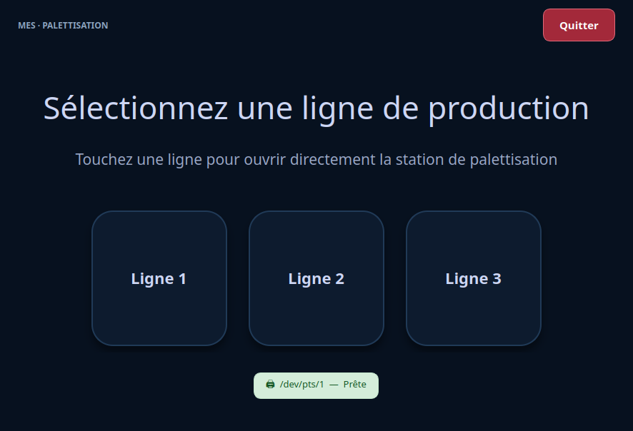
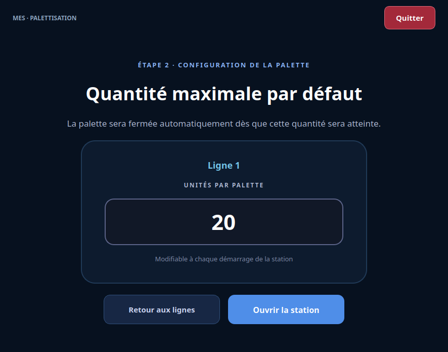
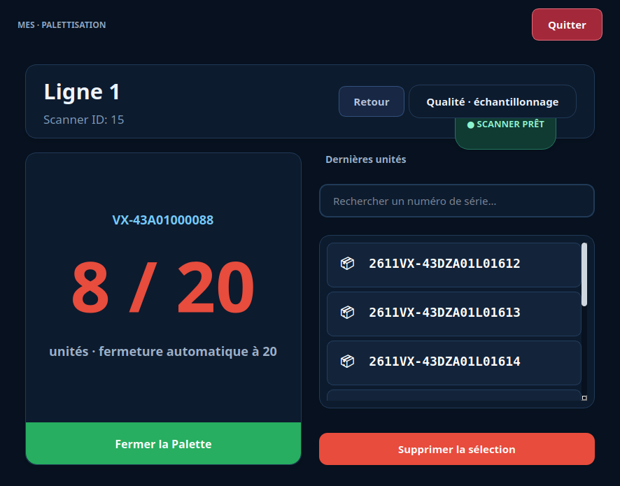

# MES Pallet Manager

> Part of the [MES platform](../README.md). Station 15: fills, closes and labels pallets. Screenshots show demo data.

| Line selection | Pallet size | Station |
| --- | --- | --- |
|  |  |  |

MES Pallet Manager is the full-screen station client used to select a production line, read unit barcodes, maintain the current pallet, remove an incorrectly scanned unit, close the pallet through the MES API, and generate/print the pallet ticket locally. The same source tree runs on Windows and Ubuntu; no source edit or OS-specific settings file is required.

The operator stays inside one stacked full-screen window: select the line, choose the default maximum quantity, then scan units. The counter displays `current / maximum`; reaching the maximum closes the pallet exactly once in the background and displays the daemon confirmation. A new scan dismisses that confirmation immediately and starts the next pallet. Manual early closure remains available through an explicit production-safe confirmation dialog.

The station needs network access to MES, a serial or USB-HID barcode scanner, and a physical label printer. Hardware failure is reported without terminating the UI. Scanner discovery is retried every eight seconds, printer state is refreshed every ten seconds, and a failed label remains in memory with an operator retry prompt.

## Architecture

| File | Responsibility |
| --- | --- |
| `mainv.py` | PyQt UI, MES requests, pallet workflow, background workers |
| `barcode.py` | Portable scanner selection plus serial and Linux HID readers |
| `printer_guard.py` | Native physical-printer availability checks |
| `pallet_ticket.py` | Local production-ticket data extraction and ZPL layout |
| `printing.py` | Shared direct-ZPL print API for Windows and Ubuntu |
| `ubuntu_usb_printer.py` | Serialized raw USB writes on Ubuntu |
| `settings.py` | Validated external configuration |
| `runtime_support.py` | Bundle/executable/log paths |
| `mainv3.spec`, `build.py` | Native PyInstaller build |
| `build_deb.py`, `packaging/linux/` | Ubuntu `.deb` package and launcher |
| `test_cross_platform.py` | Hardware-independent regression tests |

The daemon returns only the closed pallet identity and model metadata. The desktop extracts the model, lot, and pallet number, builds a centered `812 × 1150` raw Honeywell ZPL job, and submits the complete job locally. No pallet PDF is generated by the daemon.

## Requirements and development setup

Use Python 3.10 or newer and build on the target OS/architecture. PyInstaller does not cross-compile.

Windows PowerShell:

```powershell
py -m venv .venv
.\.venv\Scripts\Activate.ps1
python -m pip install --upgrade pip
python -m pip install -r requirements.txt
python mainv.py
```

Install the printer vendor's Windows driver and configure the physical ZPL printer as the default printer.

Ubuntu 22.04 or a compatible recent Debian-based system:

```bash
sudo apt update
sudo apt install python3 python3-venv python3-dev build-essential \
  libevdev-dev libegl1 libgl1 libx11-6 libxcb1 libxcb-cursor0 libxkbcommon-x11-0
python3 -m venv .venv
source .venv/bin/activate
python -m pip install --upgrade pip
python -m pip install -r requirements.txt
python mainv.py
```

The requirements use environment markers: `pywin32` is Windows-only and `evdev` is Linux-only. Ubuntu printing does not require CUPS because ZPL is written directly to the raw USB device.

## Configuration

`settings.json` is intentionally small:

```json
{
  "BASE_URL": "http://192.0.2.155:8001",
  "PORT": "AUTO",
  "PORT_BAUD": 9600,
  "PRINTER_DEV_USB": "/dev/usb/lp0",
  "PRINTER_STOPPING_SCREEN": false,
  "DEFAULT_PALLET_MAX_QUANTITY": 20
}
```

- `BASE_URL`: MES server origin. The application appends `/api`.
- `PORT`: the one cross-platform scanner value. Use `AUTO`, `COM5`, `/dev/serial/by-path/...`, `/dev/ttyUSB0`, `/dev/ttyACM0`, or `/dev/input/by-path/...-event-kbd`.
- `PORT_BAUD`: serial baud rate; ignored for HID input devices.
- `PRINTER_DEV_USB`: Ubuntu raw USB printer path; ignored on Windows.
- `PRINTER_STOPPING_SCREEN`: when `true`, blocks the station with a visible printer screen until hardware is ready. It can also be overridden with the environment variable of the same name.
- `DEFAULT_PALLET_MAX_QUANTITY`: initial value shown on the capacity step. It must be between `1` and `999`; the worker may still adjust it before opening the station.

Source runs read the project file. A Windows/Linux folder build reads the file beside the executable. The Debian package reads `/etc/mes-pallet-manager/settings.json` first and preserves it during upgrades. Restart the application after editing settings.

## Scanner detection and reconnection

An explicit path is always preferred. A value belonging to the other OS (for example `COM3` on Ubuntu) falls back to automatic detection. On Windows, AUTO prefers USB serial ports identified by pyserial, then the only serial port. On Ubuntu it prefers stable `/dev/serial/by-path` links, then `/dev/ttyUSB*` and `/dev/ttyACM*`. HID detection inspects `/dev/input/by-path/*-event-kbd` with evdev and only accepts identities resembling known barcode scanners. Ambiguous detection asks for an explicit path rather than consuming keyboard input accidentally.

The connected badge changes only after the device really opens. Disconnect, permission, busy-device, and invalid-path failures end the worker safely; the UI retries discovery automatically. Stable by-path values survive changing `ttyUSB`/event numbers and should be used where multiple devices are attached.

## Printing

On Windows, `printer_guard.py` obtains the default native printer, excludes virtual queues, and submits the generated ticket through a RAW spooler job. Install the proper ZPL printer driver and make the label printer the default.

On Ubuntu, `PRINTER_DEV_USB` must exist when a print starts. The complete ZPL job is written under a process lock to `/dev/usb/lpN`, preventing two labels from interleaving. Missing-device, permission, and write errors are displayed centrally; failed label metadata remains in memory for automatic retry after reconnection.

Useful diagnostics:

```bash
lsusb
ls -l /dev/usb/lp* /dev/serial/by-path/ /dev/input/by-path/ 2>/dev/null
udevadm info --query=all --name=/dev/usb/lp0
lpstat -p -d                 # informational if CUPS is installed
journalctl -k --since -10m | grep -Ei 'usb|tty|usblp|input'
```

## Ubuntu permissions

Never run the application as root. Add the station account to the relevant groups, then log out completely and back in:

```bash
sudo usermod -aG dialout,input,lp "$USER"
id
```

For controlled deployments, prefer device-specific udev rules using real IDs from `lsusb`:

```udev
SUBSYSTEM=="tty", ATTRS{idVendor}=="1234", ATTRS{idProduct}=="5678", GROUP="dialout", MODE="0660"
SUBSYSTEM=="input", KERNEL=="event*", ATTRS{idVendor}=="1234", ATTRS{idProduct}=="5678", GROUP="input", MODE="0660"
SUBSYSTEM=="usb", KERNEL=="lp*", ATTRS{idVendor}=="1234", ATTRS{idProduct}=="5678", GROUP="lp", MODE="0660"
```

Place these in `/etc/udev/rules.d/70-mes-pallet.rules`, run `sudo udevadm control --reload-rules && sudo udevadm trigger`, and reconnect hardware. Do not use world-writable `0666` rules.

## Tests, logging, and builds

```bash
python -m unittest -v test_cross_platform.py
python mainv.py --debug
python build.py
```

Logs are stored at `%LOCALAPPDATA%\MES-Pallet-Manager\application.log` on Windows and `${XDG_STATE_HOME:-~/.local/state}/MES-Pallet-Manager/application.log` on Ubuntu. They record OS/startup, selected scanner/device, connect/disconnect events, printer checks, print backend, conversion, permission, and printing errors. `--debug` enables additional detail.

Run `python build.py` natively on either OS. It produces the complete folder `dist/MES-PALLET-MANAGER/`; distribute that whole folder including `_internal`. Windows runs `MES-PALLET-MANAGER.exe`; Ubuntu runs `./MES-PALLET-MANAGER`.

On Ubuntu, create the recommended single package with:

```bash
python build_deb.py --version 1.0.0
sudo apt install ./dist/mes-pallet-manager_1.0.0_amd64.deb
mes-pallet-manager
```

The architecture suffix is detected and may differ from `amd64`. The package installs under `/opt/mes-pallet-manager`, adds `/usr/bin/mes-pallet-manager`, installs a desktop entry, and places configuration under `/etc/mes-pallet-manager`. Uninstall with `sudo apt remove mes-pallet-manager`.

## Troubleshooting

- **Scanner not detected/wrong scanner:** set `PORT` to its stable by-path entry; inspect `python -m serial.tools.list_ports -v`, `/dev/serial/by-path`, and `/dev/input/by-path`.
- **Scanner permission denied:** inspect `ls -l` and `id`; join `dialout` for serial or `input` for HID, then log out/in. Check udev IDs and rules.
- **Scanner reconnect:** reconnect it and wait up to eight seconds. With AUTO, ambiguous devices require an explicit stable path.
- **Printer not detected/offline:** Windows must have a ready physical default queue; check Settings/Printers and print a test page. Ubuntu must expose the configured `/dev/usb/lpN`; check cable, power, `lsusb`, `usblp`, group `lp`, and kernel logs.
- **Ubuntu printer path changes:** update `PRINTER_DEV_USB` from `/dev/usb/lp0` to the actual node or add a device-specific stable udev symlink.
- **No pallet label:** inspect the application log, verify the printer understands ZPL and uses 203 DPI, and confirm `PRINTER_DEV_USB`. A non-ZPL printer is incompatible with the raw Ubuntu backend.
- **Backend unreachable:** verify `BASE_URL`, `curl -v "$BASE_URL/api/production-lines"`, routing/firewall, and server availability. The selection screen offers Retry.
- **Development works but package fails:** distribute all of `dist/MES-PALLET-MANAGER`, rebuild with `--clean`, and inspect the log. Never copy only the executable from an onedir build.
- **Qt plugin error:** install the listed X11/Qt runtime libraries; inspect `QT_DEBUG_PLUGINS=1 ./MES-PALLET-MANAGER` from a terminal.
- **PyInstaller missing import:** build from the requirements-installed environment and check `build/MES-PALLET-MANAGER/warn-*.txt`; add a verified dynamic module to `hiddenimports`.
- **Ubuntu package fails:** run `sudo apt --fix-broken install`, `dpkg --print-architecture`, and `dpkg-deb -I package.deb`; build the package natively on the same Ubuntu architecture.
