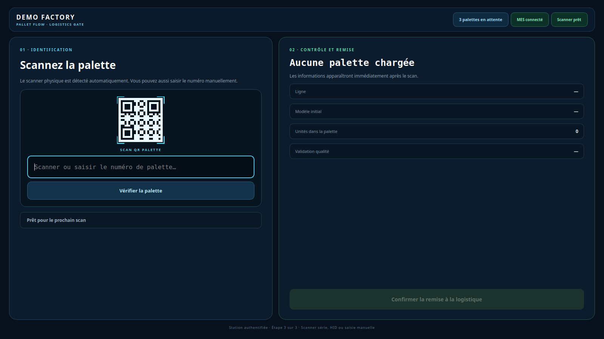
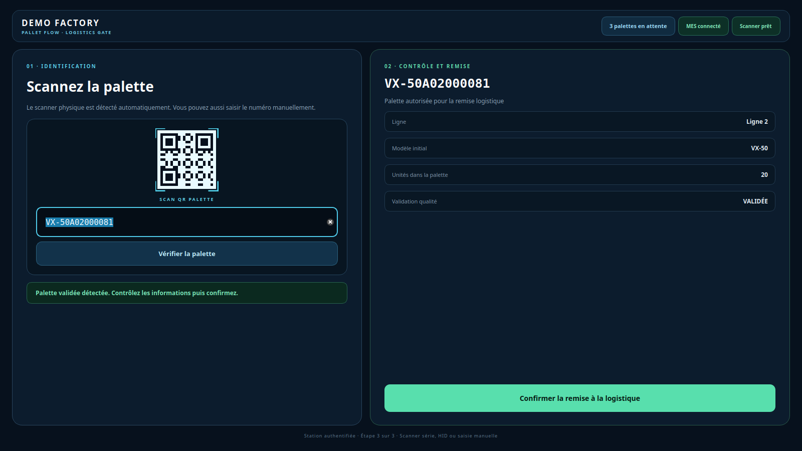

# MES Pallet to Logistics

> Part of the [MES platform](../README.md). Final station: completes pallets already validated by quality. Screenshots show demo data.

| Waiting | Validated pallet |
| --- | --- |
|  |  |

Dedicated workstation for the last pallet workflow step. A keyboard-emulating
hand scanner (or manual entry) loads only a quality-validated pallet. The
operator verifies the line, model and unit count, then confirms the transfer;
the pallet becomes `completed`.

The application follows the same workstation architecture as the production
desktop applications:

- a blocking network/authentication wall until the MES daemon is reachable;
- asynchronous API calls so the interface never freezes;
- live scanner connection state with automatic reconnection;
- serial scanners on Windows/Linux and Linux HID scanners;
- keyboard-wedge scanners and manual entry through the permanently focused
  input field;
- immediate submission for serial, HID and fast keyboard-wedge scans, while
  manual typing waits for the **Vérifier la palette** button;
- duplicate-scan protection and responsive layouts for common PC resolutions.

## Run

```bash
python -m venv .venv
.venv/bin/pip install -r requirements.txt
.venv/bin/python app.py
```

Set the daemon URL and the same station secret as the daemon's
`LOGISTICS_STATION_SECRET` in `settings.json`. The existing authentication
mechanism is preserved: every logistics request sends `x-station-secret`.

Scanner configuration:

- `PORT: "auto"` safely auto-detects one scanner;
- Windows serial example: `COM4`;
- Linux serial example: `/dev/serial/by-path/...`;
- Linux HID example: `/dev/input/by-path/...-event-kbd`;
- `SCANNER_KEYBOARD_LAYOUT` accepts `qwerty` or `azerty`.

Build a standalone executable with `python build.py`.

Build the installable Ubuntu package with:

```bash
python build_deb.py --version 1.0.0
sudo apt install ./dist/mes-pallet-to-logistics_1.0.0_amd64.deb
```

The package installs the application in `/opt/mes-pallet-to-logistics`, keeps
the upgrade-safe station configuration in
`/etc/mes-pallet-to-logistics/settings.json`, and adds the
`mes-pallet-to-logistics` launcher.
