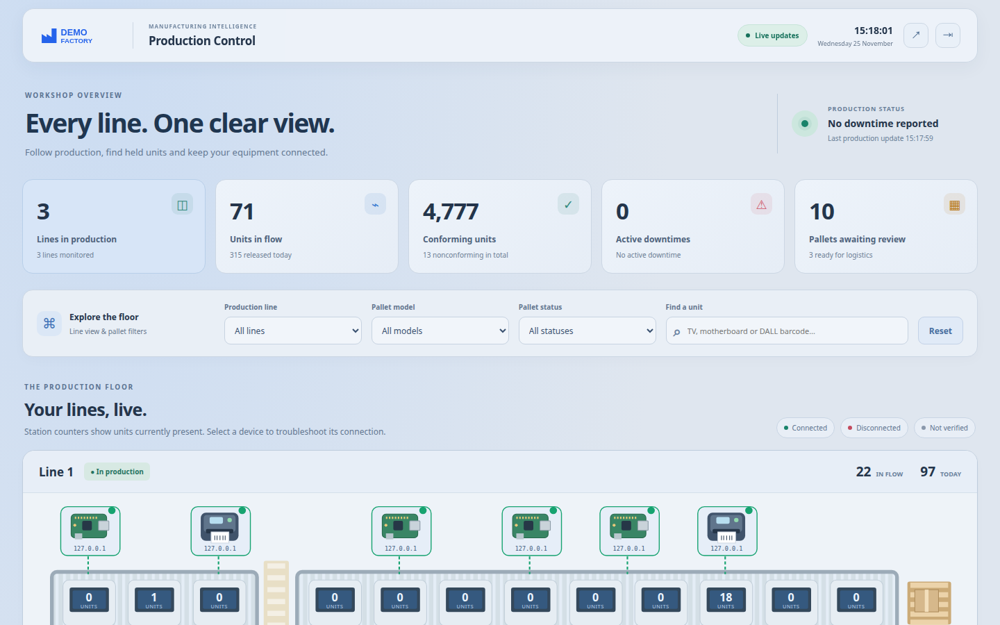
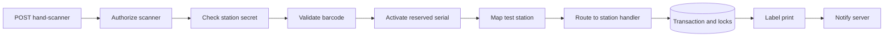
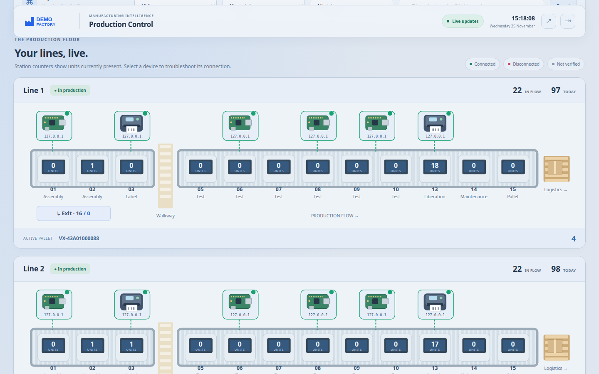

# MES Daemon

Shop-floor API. Scanners and workstations send every barcode here. The daemon validates it, moves the unit through its lifecycle, prints labels, manages pallets and shows the floor in a live monitor.



## Stack

Node.js, Express 5, Sequelize 6, PostgreSQL, Socket.IO, Puppeteer with Chromium for PDF labels, bwip-js and qrcode.

## Responsibilities

| Area | Routes |
| --- | --- |
| Scan entry point for every station | `POST /api/hand-scanner` |
| Lines, units, components and defects | `/api/production-lines`, `/api/production-units`, `/api/components`, `/api/pannes` |
| Pallets | `/api/pallets` |
| Logistics hand-over | `/api/pallets/logistics/*` |
| Quality pallets | `/api/quality-pallets` |
| Floor monitor | `/api/monitor` and Socket.IO |
| Health | `GET /api/health` |

## Scan pipeline



- `scanner_assignment` identifies line and station (line 1: 1 to 16, line 2: 101 to 116, line 3: 201 to 216).
- Station 3 allocates the TV serial. Duplicate labels need an authorized reprint.
- Scan recovery can complete a missed earlier scan and records what it did on the unit.
- Units produced without a plan are accepted as unplanned production.
- Automatic palletization can stand in for a missing pallet station.

## Floor monitor

A password-protected console on the daemon port shows units at each station, pallets, downtime, unit search and device reachability (ICMP).



## Structure

```text
controllers/  stations, pallets, quality pallets, monitor data
middlewares/  scanner and station authorization, barcode validation
services/     PDF labels, palletization, recovery, downtime, device monitor
script/       production and quality simulators, maintenance tools
public/dist/  hand-written monitor interface
*.html        label templates
test/, tests/ node:test suites
```

## Configuration

| Variables | Purpose |
| --- | --- |
| `PORT`, `ALLOWED_ORIGINS`, `DB_*` | Service and database |
| `SERVER_INTERNAL_URL`, `INTERNAL_SECRET` | Notifications to the server |
| `*_STATION_SECRET` | One secret per workstation type |
| `REPRINT_PASSWORD` | Duplicate label authorization |
| `AUTO_PALLETIZATION_*` | Automatic pallet station |
| `MONITOR_*` | Monitor login and monitored devices |

Server-side printing calls the [`mesp`](../../MES-Printers-master/README.MD) command.

## Run

```bash
npm ci
cp .env.example .env
node server.js
npm test
```

Simulators are documented in [UNPLANNED-SIMULATION.md](script/UNPLANNED-SIMULATION.md) and [QUALITY-SIMULATION.md](script/QUALITY-SIMULATION.md). They write real rows, so use a demo database.
