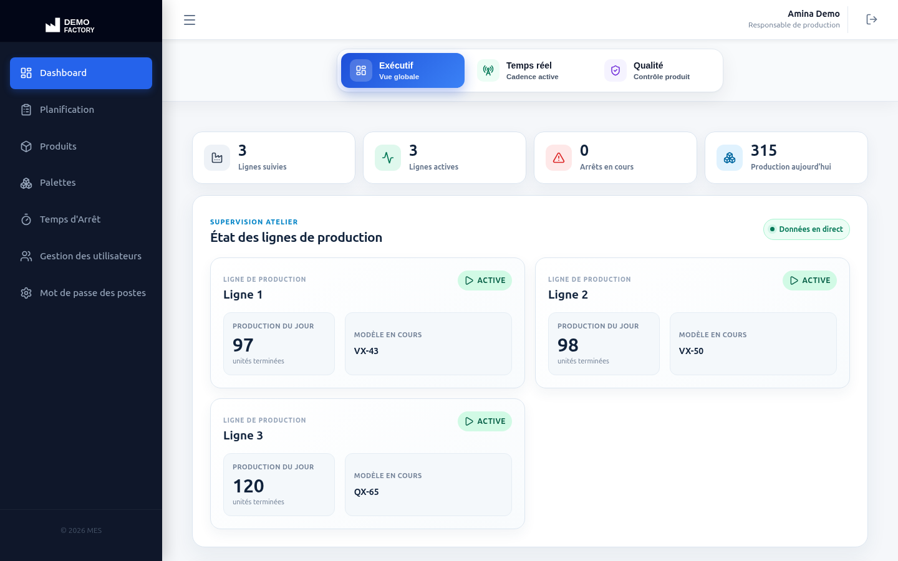

# MES Server

Main API of the MES platform. It owns the schema, the business rules used by office and quality staff, and the real-time events shown on dashboards. It also serves the built [React application](../MES-client-side/README.md).



## Stack

Node.js, Express, Sequelize 6, PostgreSQL, Socket.IO, JWT, Pino, node-cron, Nodemailer, Firebase Admin (optional).

## Responsibilities

| Area | Routes | Description |
| --- | --- | --- |
| Authentication | `/api/auth` | Web and app login, password reset, profile |
| Users | `/api/user` | Accounts, roles, activity, lifecycle |
| Catalog | `/api/models`, `/api/components`, `/api/lots` | TV models, bills of materials, components, lots |
| Stock | `/api/stock-transactions` | Stock in, out, reserved, draft |
| Planning | `/api/planification` | Plans, days, shifts, approvals, edits of active plans |
| Lines | `/api/production-lines` | Lines and stations |
| Units | `/api/production-units` | Search, traceability, Excel export |
| Quality | `/api/pannes`, `/api/corrective-actions`, `/api/repair-sources` | Quality catalogs |
| Repair | `/api/repairs` | Queue, start, complete, abandon, timing |
| Sampling | `/api/sampling` | Types, tests, groups, unit decisions |
| Pallets | `/api/pallets` | Search, validation, export |
| Passwords | `/api/station-passwords` | Managed passwords for protected station actions |
| Downtime | `/api/downtimes` | Automatic and manual stops |
| Offline labels | `/api/offline-barcodes` | Reserved serials |
| Dashboards | `/api/dashboard`, `/api/display/*` | Statistics and wall displays |

## Structure

```text
config/       database, optional Firebase, initial seed
controllers/  HTTP handlers
middlewares/  authentication, roles, display access, rate limits, uploads
migrations/   ordered SQL migrations with checksums
models/       one Sequelize model per table, associations.js
routes/       route declarations
services/     planning, downtime, statistics, sockets, exports, migrations
scripts/      deploy, demo seed, repair and verification tools
test/         node:test suites
utils/        barcode, timing, statistics and policy rules
docs/         design documents
```

## Design decisions

- **The schema never changes on startup.** `npm run db:deploy` previews, `npm run db:deploy:apply` applies. The server stops if migrations are missing.
- **Row locks and one-way transitions** protect pallets, sampling and repair from simultaneous actions.
- **Display links** are random, stored hashed and revocable, with their own rate limits.
- **Statistics rules live in pure functions** so they can be tested without a database.
- **Automatic downtime** compares the last scan of each line part with a configured threshold during working hours.

Further reading: [codification](docs/CODIFICATION_ARCHITECTURE.md), [pallet workflow](docs/PALLET_WORKFLOW.md), [quality data model](docs/quality-data-model.md), [sampling](docs/quality-sampling.md), [repair timing](docs/repair-timing.md), [unit identity](docs/unit-identity.md), [deployment](docs/PRODUCTION_DEPLOYMENT.md).

## Configuration

Copy `.env.example` to `.env`.

| Variables | Purpose |
| --- | --- |
| `PORT`, `FRONTEND_URL`, `ALLOWED_ORIGINS` | HTTP and CORS |
| `DB_*` | PostgreSQL |
| `JWT_*` | Signing key, issuer, audience, lifetime |
| `INTERNAL_SECRET` | Shared with the daemon |
| `DISPLAY_*` | Wall display links and limits |
| `SMTP_*`, `FROM_*` | Email |
| `DOWN_TIME_RECORD` | Idle threshold in milliseconds |
| `SEED_ADMIN_PASSWORD` | Password of the first account created by the initial seeder |
| Role variables | Role names stored in the database |

Push notifications need a Firebase key in `google-services.json`. Without the file the server runs and push attempts fail with a logged error.

## Run

```bash
npm ci
npm run db:deploy:apply
npm run db:seed-demo
node server.js
npm test
```

`db:seed-demo` refuses to write unless the database is local, empty of units and has `demo` in its name.
